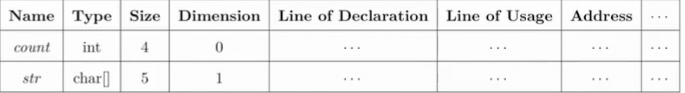
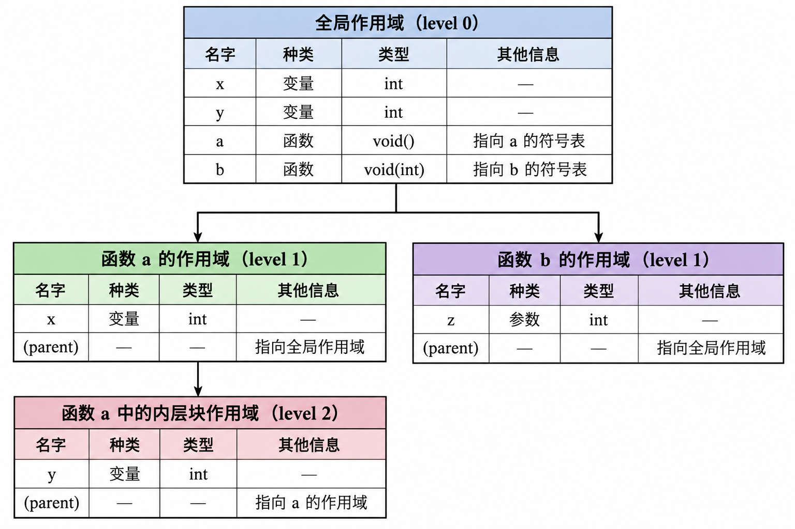

接下来，我们开始进入语义分析。

语义分析主要是在语法分析生成了AST后，检查程序是否符合语言的语义规则，并为后续中间代码生成提供必要的信息。

考虑到实用性，我们重点学习的对象是类型检查，符号检查。

注: 这一章与Lab的关联不大

## 符号表

在语义分析中，一个非常重要的工具就是**符号表（Symbol Table）**。

符号表是一种用于记录和管理程序中各类符号及其相关信息的数据结构。在具体实现中，我们通常可以将其组织为哈希表，以符号名称作为键（Key），以符号的属性信息作为值（Value）。这些属性通常包括符号的类型、作用域以及其他语义信息，如下图所示：



在理解符号表时，我们还需要引入一个重要概念：**作用域（Scope）**。

顾名思义，作用域描述的是一个符号在程序中的有效范围。在一些结构较为简单的领域特定语言（DSL）中，符号可能只存在于全局作用域；而在通用编程语言（GPL）中，作用域通常具有嵌套关系。这意味着一个程序中可能存在多个作用域，不同作用域可以拥有各自的符号表，并通过父子关系组织成一棵树。

我们可以通过下面的例子来理解这一点：

```c
int x;
int y;
void a()
{
    int x;
    x = 1;
    y = 2;
    { int y = x; }
}
void b(int z)
{ }
```

对于这段程序，其对应的符号表可以组织为如下树状结构：



从这个例子中，我们可以直观地看到三个层次的作用域：

- **全局作用域**：包含全局变量 `x`、`y`，以及函数 `a`、`b` 的声明。

- **函数作用域**：对应函数内部的作用域，例如函数 `a` 中定义的局部变量 `x`，以及函数 `b` 的参数 `z`。

- **局部块作用域**：由嵌套的代码块引入，例如函数 `a` 内部额外的 `{}`，其中定义了局部变量 `y`。

这里还有一个值得注意的现象：**不同作用域中可以存在同名符号**。

例如，函数 `a` 中的局部变量 `x` 会遮蔽（Shadow）全局变量 `x`。因此，执行 `x = 1` 时，访问的是函数内部的 `x`；而执行 `y = 2` 时，由于当前作用域中没有定义 `y`，便会沿着作用域的父子关系向外查找，最终找到全局变量 `y`。

类似地，在最内层代码块中，`int y = x` 定义了一个新的局部变量 `y`，而其初始化表达式中的 `x` 则引用函数 `a` 中定义的局部变量。

因此，**符号表不仅用于存储符号信息，还需要配合作用域规则，完成符号的查找、名称解析以及重复定义等语义检查**。

考虑到我们的 Lab 与课程所采用的实现方式存在一定差异，这里只介绍符号表及作用域的基本概念，不再展开具体的实现细节。

## 属性文法

在前面的章节中，我们已经介绍了词法分析和语法分析。通过语法分析，我们可以根据文法规则识别程序的语法结构，并构建出对应的抽象语法树（AST）。

但传统的上下文无关文法只能描述程序的语法结构，并不能直接表达程序中更丰富的语义信息。

例如，对于下面这个表达式：

```text
1 + 2 * 3
```

通过语法分析，我们能够确定表达式中各个运算符的优先级，并构建出对应的语法树。

但如果我们希望在分析语法结构的同时，进一步计算表达式的值、推导表达式的类型，又应该怎么做呢？

一个很自然的想法就是：**能否为文法符号附加一些属性，并在应用文法规则时，根据这些规则计算属性值？**

这就是属性文法（Attribute Grammar）的基本思想。

属性文法是对上下文无关文法的一种扩展。它通过为文法符号定义**属性（Attribute）**，并为产生式附加**语义规则（Semantic Rule）**，描述这些属性应该如何计算和传递。

这样，我们就能够将语义计算与语法规则联系起来，在语法分析过程中，或者在语法分析完成后，根据语法结构计算文法符号的属性值。

根据属性之间的依赖关系，我们通常将属性分为两类：

- **综合属性（Synthesized Attribute）**

- **继承属性（Inherited Attribute）**

### 综合属性

综合属性是指一个节点的属性值由其子节点的属性值计算得到。

换句话说，综合属性的信息传递方向是**自底向上**的。

例如，我们可以考虑下面这个产生式：

```text
E → E₁ + T
```

如果我们希望计算表达式的值，就可以为文法符号 `E` 和 `T` 定义一个名为 `val` 的属性，并添加对应的语义规则：

```text
E.val = E₁.val + T.val
```

这里的 `E₁` 表示产生式右侧的 `E`，下标只是为了区分同名的文法符号。

这样，当 `E₁` 和 `T` 的 `val` 已经计算完成后，我们就可以进一步计算出 `E` 的 `val`。

对于前面提到的算术表达式，我们可以定义下面这组产生式及其语义规则：

```text
E → E₁ + T      { E.val = E₁.val + T.val }
E → T           { E.val = T.val }

T → T₁ * F      { T.val = T₁.val * F.val }
T → F           { T.val = F.val }

F → num         { F.val = num.lexval }
```

其中，`num.lexval` 表示词法分析得到的数字字面量的值。

对于表达式 `1 + 2 * 3`，我们就可以从叶子节点开始，依次计算各个文法符号的属性：

```text
2 * 3 = 6
1 + 6 = 7
```

最终，根节点的 `val` 就是 `7`。

可以看到，综合属性的计算过程与语法树的自底向上遍历非常自然地对应起来。

需要注意的是，这里的 `val` 只是我们为了方便理解而定义的属性。在实际编译器中，综合属性也可以表示表达式的类型、常量求值结果等其他语义信息。

### 继承属性

综合属性描述的是如何由子节点计算父节点的属性。但是，在实际的语义分析中，并不是所有的信息都能够通过子节点获得。

有时候，一个节点还需要从其父节点或者兄弟节点获取一些信息。

这就需要引入**继承属性（Inherited Attribute）**。

继承属性通常用于将上下文信息传递给当前节点，例如当前作用域、符号表环境以及类型约束等。

我们可以结合上一节的符号表来理解这一点。

例如：

```c
int x;

void a()
{
    int y;
    y = x + 1;
}
```

当我们分析表达式 `x + 1` 时，需要知道其中的 `x` 是什么类型。

但是，仅仅观察这个表达式的语法结构，并不能确定 `x` 的类型。我们还需要根据当前作用域，去符号表中查找 `x` 的定义。

因此，我们可以为表达式定义一个继承属性 `env`，表示当前的符号表环境。

例如，对于赋值语句：

```text
Stmt → LVal "=" Exp ";"
```

我们可以定义如下语义规则：

```text
LVal.env = Stmt.env
Exp.env  = Stmt.env
```

这里，`Stmt.env` 是从外层作用域传递过来的符号表环境，而 `LVal` 和 `Exp` 则继承了这一环境。

当表达式中出现标识符 `x` 时，就可以利用传递下来的 `env` 查找其定义，并进一步计算表达式的类型。

因此，继承属性的主要作用，就是**将语义分析所需要的上下文信息传递给相应的语法节点**。

### 属性文法与语义分析

通过前面的例子，我们可以发现，综合属性与继承属性实际上描述了两种不同的信息传递方式：

- **综合属性**：自底向上，根据子节点的信息计算父节点的属性。

- **继承属性**：从父节点或兄弟节点获取信息，用于当前节点的属性计算。

这两种属性通常会配合使用。

例如，在类型检查中，我们可以先通过继承属性将当前的符号表环境传递给表达式，再通过综合属性逐层计算表达式的类型，最后判断赋值语句左右两侧的类型是否兼容。

这里还需要注意一个问题：**属性文法定义的是属性之间的计算关系，而不是属性计算必须发生的具体时机。**

在实际编译器中，我们既可以在语法分析过程中，根据产生式执行对应的语义计算，也可以先构建 AST，再通过遍历 AST 完成属性的计算。

前者与我们后面可能接触到的语法制导翻译（Syntax-Directed Translation）密切相关，而后者也是实际编译器中常见的实现方式。

至此，我们就对语义分析中两个重要的概念有了基本认识：**符号表负责管理符号及其相关信息，而属性文法为语义信息的计算与传递提供了一种形式化描述方式。**

考虑到我们的 Lab 与课程的具体实现存在一定差异，这里主要介绍属性文法的基本思想，不再展开具体的实现细节。
