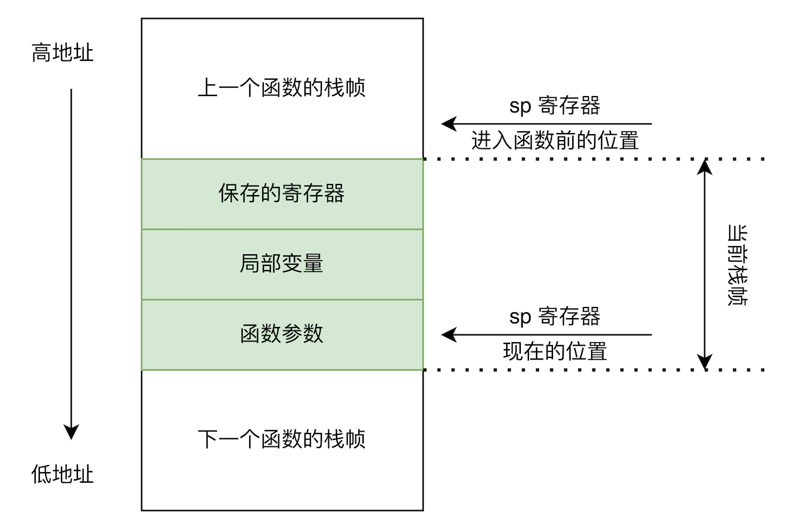

接下来，我们将在现有编译器的基础上，进一步支持常量与变量的处理。

具体来说，完成本章后，我们的编译器将支持常量/变量的定义与赋值语句，能够编译如下 SysY 程序：

```c
int main() {
  const int x = 233 * 4;
  int y = 10;
  y = y + x / 2;
  return y;
}
```

我们先从常量的支持开始。

## 常量

我们仍然遵循以前实现流程。

在本小节中，我们新增或调整的语法规则如下:

```text
Decl          ::= ConstDecl;
ConstDecl     ::= "const" BType ConstDef {"," ConstDef} ";";
BType         ::= "int";
ConstDef      ::= IDENT "=" ConstInitVal;
ConstInitVal  ::= ConstExp;

Block         ::= "{" {BlockItem} "}";
BlockItem     ::= Decl | Stmt;

LVal          ::= IDENT;
PrimaryExp    ::= "(" Exp ")" | LVal | Number;

ConstExp      ::= Exp;
```

在本小节中，我们会处理如下程序:

```c
int main()
{
    const int x = 1 + 1;
    return x;
}
```

整体实现思路与前几次实验一脉相承，主要的新变化在于 EBNF 中首次出现了 `{ ... }` 记号——它代表花括号内的符号可以重复出现 0 次或多次。下面我们重点看如何在 Parser 与 AST 构建中优雅地处理它。

### 词法分析与语法分析

观察新增的语法规则，其中出现的 `=`、`,`、`;` 等单字符符号，此前 Lexer 末尾的兜底规则 `. { return yytext[0]; }` 已经能直接将字符本身作为 Token 返回，因此无需额外处理。真正需要新增的词法单元只有关键字 `const`。

我们只需在 `sysy.l` 中将其置于 `Identifier` 匹配规则之前即可（否则 `const` 会被优先匹配成普通标识符 `IDENT`）：

```text
"const"         { return CONST;  }

{Identifier}    { yylval.str_val = new string(yytext); return IDENT; }
```

补充了词法规则之后，我们可以开始准备着手构建AST以及语法规则的更改了。

为了保证修改过程的连贯性，推荐先从语句块 `Block` 的结构改造入手，跑通变长列表骨架后再向下扩展。原本的规则为：

```text
Block : "{" Stmt "}"
```

现在变成

```text
Block : "{" {BlockItem} "}";
BlockItem : Decl | Stmt;
```

面对 `{BlockItem}` 这种重复 0 次或多次的结构，我们在 C++ AST 中使用 `std::vector` 来存储子节点列表：

```cpp
class BlockAST : public BaseAST
{
public:
    std::vector<std::unique_ptr<BaseAST>> block_items;
    void Dump() const override
    {
        std::cout << "BlockAST { ";
        for (const auto& item : block_items)
        {
            std::cout << " ";
            item->Dump();
        }
        std::cout << " }";
    }
};

class BlockItemAST : public BaseAST
{
public:
    std::unique_ptr<BaseAST> stmt;
    std::unique_ptr<BaseAST> decl;
    enum class Kind { Stmt, Decl };
    Kind kind;
    void Dump() const override
    {
        std::cout << "BlockItemAST { ";
        switch (kind)
        {
            case Kind::Stmt: stmt->Dump(); break;
            case Kind::Decl: decl->Dump(); break;
            default: throw std::runtime_error("Invalid block item kind");
        }
        std::cout << " }";
    }
};
```

相应地，在 Bison（`sysy.y`）的 `%union` 中新增一个 `vec_val` 指针类型，并引入辅助非终结符 `BlockItemList`，通过左递归不断向 `vector` 中追加元素：

```cpp
%union {
  std::string *str_val;
  int int_val;
  BaseAST *ast_val;
  std::vector<std::unique_ptr<BaseAST>> *vec_val;
  UnaryOpKind unary_op_val;
  BinaryOpKind binary_op_val;
}

%type <vec_val> BlockItemList

Block
  : '{' BlockItemList '}' {
    auto ast = new BlockAST();
    ast->block_items = std::move(*unique_ptr<vector<unique_ptr<BaseAST>>>($2));
    $$ = ast;
  }
  ;

BlockItemList
  : {
    $$ = new vector<unique_ptr<BaseAST>>();
  }
  | BlockItemList BlockItem {
    $1->push_back(unique_ptr<BaseAST>($2));
    $$ = $1;
  }

BlockItem
  : Decl {
    auto ast = new BlockItemAST();
    ast->kind = BlockItemAST::Kind::Decl;
    ast->decl = unique_ptr<BaseAST>($1);
    $$ = ast;
  }
  | Stmt {
    autp ast = new BlockItemAST();
    ast->kind = BlockItemAST::Kind::Stmt;
    ast->stmt = unique_ptr<BaseAST>($1);
    $$ = ast;
  }
  ;
```

之后，我们就可以开始从Decl开始递归往下开始补充和实现了。内容与之前没有很大的差异，这里就不过多赘述了

### 语义分析

本节的语义分析相比前几节略微复杂，因为语法中正式引入了常量与变量。为了在语义分析阶段追踪标识符的属性，我们需要在编译器中引入一个核心数据结构——符号表（Symbol Table）。

符号表用于记录作用域内所有已定义符号的信息。由于目前尚未引入多函数、全局变量以及嵌套语句块，程序中暂时只有 `main` 函数体这一层扁平作用域。因此在本阶段，符号表主要负责维护 `main` 函数内常量标识符与其编译期数值之间的映射关系。

具体来说，我们的符号表应该支持如下操作：

- 插入符号定义：向符号表中添加一个常量符号，同时记录这个符号的常量值，也就是一个32位整数

- 确认符号定义是否存在：给定一个符号，查询符号表中是否存在这个符号的定义

- 查询符号定义：给定一个符号，返回这个符号对应的常数值

在具体实现上，由于我们只需要按名字精确查找而无需按字典序遍历，底层采用哈希表 `std::unordered_map` 是最明智的选择（增查均为 $O(1)$ 均摊开销）。为了兼顾紧接着要实现的“变量”，我们先定义一个带类型标签的 `Symbol` 结构体

```cpp
struct Symbol
{
    enum class Kind { Const, Var};
    Kind kind;
    int const_val = 0;
    std::string ir_name;
};
```

之后，我们就可以按照要求实现符号表的定义即可:

```cpp
class SymbolTable
{
    public:
        void InsertConst(const std::string& name, int val)
        {
            auto [it, inserted] = table_.emplace(
                name, Symbol{Symbol::Kind::Const, val, ""}
            );
            if( !inserted)
            {
                throw std::runtime_error("Symbol redefined: " + name);
            }
        }

        bool Exists(const std::string& name) const
        {
            return table_.find(name) != table_.end();
        }

        const Symbol& Lookup(const std::string& name) const
        {
            auto it = table_.find(name);
            if( it == table_.end())
            {
                throw std::runtime_error("Undefined symbol: " + name);
            }
            return it->second;
        }
        
        int LookupConst(const std::string& name) const
        {
            const Symbol& sym = Lookup(name);
            if( sym.kind != Symbol::Kind::Const)
            {
                throw std::runtime_error("Not a constant: " + name);
            }
            return sym.const_val;
        }

    private:   
        std::unordered_map<std::string, Symbol> table_;
};
```

那么该如何维护并使用这张符号表呢？在单遍编译（One-pass）的设计下，我们无需单独拆出一个语义分析 Pass，而是直接在 `IRGenerator` 遍历 AST 生成 Koopa IR 的过程中，同步完成编译期常量求值以及符号表的写入与查询。

在动手实现之前，我们先对 `IRGenerator` 的传参框架做一次重构。

此前，我们在递归函数中一路传递 `BasicBlock& bb` 和 `int& next_id`。引入符号表后，如果继续往十几个表达式生成函数的参数列表里堆砌参数，后续再扩展多基本块切换或函数上下文时维护成本会非常高。因此，我们将生成期的状态统一收敛到 `IRContext` 上下文结构体中：

```cpp
struct IRContext
{
    Function* current_func = nullptr;
    BasicBlock* current_bb = nullptr;
    int next_id = 0;
    SymbolTable symbol_table;

    void Emit(std::unique_ptr<Instruction> inst)
    {
        current_bb->insts.push_back(std::move(inst));
    }
};
```

这样一来，`IRGenerator` 本身依然保持无状态（所有方法均为 `const`），而所有递归函数只需统一传递一个 `IRContext& ctx` 引用即可。

接下来我们看看如何进行编译期求值以及符号表的维护。对此，我们重点关注两个问题，一个是何时触发编译期求值以及符号表的维护，另一个是如何进行编译期求值和符号表的维护。

对于第一个问题，我们可以简单概括为**一处写入，两处读取：**

- 一处写入：当我们遍历语句块`BlockAST`遇到声明分支时触发(`BlockItemAST::Kind::Decl`).我们只需要对等号右侧的`ConstExp`进行编译期求值，算出具体的 `int` 结果后，调用`ctx.symbol_table.InsertConst()` 将其记录到符号表中即可。

- 读取时机1：常量在定义时允许引用此前已定义的常量（例如 `const int a = 1, b = a + 2;`）。在求值 `b` 的初始表达式时，一旦 `EvalPrimaryExp` 遇到左值 `LVal`，便从符号表中查出 `a` 的常量值直接参与计算。

- 读取时机2：在普通执行语句（如 `return x + 1;`）中，当 `GeneratePrimaryExp` 遇到 `LVal` 时，从符号表中查询该常量的值，直接构造一个立即数节点 `IRInteger(val)` 返回给上层表达式。

对于具体实现而言

在 `EmitConstDecl` 中，我们会依次遍历同一条声明语句中的多个 `ConstDef`（如 `const int x = 1, y = x + 1;`）。

由于是严格按从左到右的顺序边求值边插入符号表，后面的定义天然能够访问到前面刚刚注册的常量：

```cpp
void IRGenerator::EmitConstDecl(const ConstDeclAST& ast, IRContext& ctx) const
{
    for (const auto& def_ptr : ast.const_defs)
    {
        const auto& def = static_cast<const ConstDefAST&>(*def_ptr);
        const auto& init_val = static_cast<const ConstInitValAST&>(*def.const_init_val);
        const auto& const_exp = static_cast<const ConstExpAST&>(*init_val.const_exp);

        int val = EvalConstExp(const_exp, ctx);
        ctx.symbol_table.InsertConst(def.ident, val);
    }
}
```

为了在编译期直接算出 `ConstExp` 的整数值，我们参考表达式从AST到IR的转换，实现了一组返回 `int` 的递归求值函数（`EvalConstExp` $\rightarrow$ `EvalExp` $\rightarrow \dots \rightarrow$ `EvalPrimaryExp`）。

最后，在原有的运行期表达式生成函数 `GeneratePrimaryExp` 中补齐 `PrimaryExpAST::Kind::LVal` 分支。查询符号表得到常量整数后，直接将其包装为 `IRInteger` 即可无缝接入原有的表达式生成链路：

```cpp
else if (ast.kind == PrimaryExpAST::Kind::LVal)
{
    const auto& lval = static_cast<const LValAST&>(*ast.lval);
    int val = ctx.symbol_table.LookupConst(lval.ident);
    return std::make_unique<IRInteger>(val);
}
```

### IR生成 & CodeGen

所有的常量定义均已在编译期被求值, 所以:

- `Exp` 里, 所有出现 `LVal` 的地方均可直接替换为整数常量.

- 因上一条, 常量声明本身不需要生成任何 IR.

综上所述, 本节的 IR 生成部分不需要做任何修改.

同理 CodeGen也不会发生任何更改


## 变量和赋值

在本节中，我们继续实现编译器对于变量和赋值的支持。在本小节之后，代码可以处理如下代码的编译：

```c
int main() {
  int x = 10;
  x = x + 1;
  return x;
}
```

具体来说，语法的新增与变更情况如下:

```text
Decl          ::= ConstDecl | VarDecl;
ConstDecl     ::= ...;
BType         ::= ...;
ConstDef      ::= ...;
ConstInitVal  ::= ...;
VarDecl       ::= BType VarDef {"," VarDef} ";";
VarDef        ::= IDENT | IDENT "=" InitVal;
InitVal       ::= Exp;

...

Block         ::= ...;
BlockItem     ::= ...;
Stmt          ::= LVal "=" Exp ";"
                | "return" Exp ";";
```

### 词法分析与语法分析

观察上述语法可以发现，本节并未引入任何新的关键字或运算符（`int`、`=`、`,`、`;` 等词法单元此前均已支持），因此词法分析器（`sysy.l`）无需任何改动，改动重点集中在 Bison 语法规则（`sysy.y`）与 AST 节点定义（`ast.hpp`）上。

我们需要为 `Decl` 扩展 `VarDecl` 分支，为 `Stmt` 扩展 `LVal "=" Exp ";"` 赋值分支，并相应补齐 `VarDeclAST`、`VarDefAST`（区分带初值 `Init` 与无初值 `NoInit`）以及 `InitValAST` 等节点类。整体实现模式与上一节的常量声明高度一致，此处不再赘述。

### 语义分析

与处理常量类似，我们继续通过符号表（`SymbolTable`）维护标识符的语义信息，但变量与常量有着本质区别：

- **常量**的值在编译期即可完全确定，符号表直接保存其具体的整数值；

- **变量**的值只有在程序运行期才能确定并可能多次改变，因此符号表保存的不再是“具体数值”，而是该变量在 IR 中通过 `alloc` 分配得到的**内存符号名（即地址）**。

因此，符号表中的条目需要能够同时描述常量与变量两种符号。得益于上一节的前瞻性设计，我们在定义 `Symbol` 结构体时就已经预留了 `Kind::Var` 与 `ir_name` 字段，无需修改 `Symbol` 本身的结构，只需在 `symbol_table.hpp` 中补充变量的插入与查询接口即可：

```cpp
void InsertVar(const std::string& name, const std::string& ir_name)
        {
            auto [it, inserted] = table_.emplace(
                name, Symbol{Symbol::Kind::Var, 0, ir_name}
            );
            if( !inserted )
            {
                throw std::runtime_error("Symbol redefined: " + name);
            }
        }
 const std::string& LookupVar(const std::string& name) const
        {
            const Symbol& sym = Lookup(name);
            if( sym.kind != Symbol::Kind::Var)
            {
                throw std::runtime_error("Not a variable: " + name);
            }
            return sym.ir_name;
        }
```

之后我们就可以像之前处理常量一样处理变量了，另外，我们需要注意的是，以下情况属于语义错误：

- 在进行常量求值时, 从符号表里查询到了变量而不是常量.

- 在处理赋值语句时, 赋值语句左侧的 `LVal` 对应一个常量, 而不是变量.

- 其他情况, 如符号重复定义, 或者符号未定义.

### IR生成

仅凭此前介绍的 Koopa IR 指令还不足以表达变量与赋值。因为 Koopa IR 采用 **SSA（Static Single Assignment，静态单赋值）** 形式，每个符号最多只能被定值一次，不能把源程序中的变量直接翻译成多次赋值的临时寄存器。例如，下面的写法在 Koopa IR 中是**非法**的：

```text
fun @main(): i32 {
%entry:
  %0 = 10
  %0 = add %0, 1
  ret %0
}
```

为了在 SSA 形式下正确表达可变的局部变量，我们需要引入三条内存操作指令：`alloc`、`load` 和 `store`。用这三条指令改写本节示例程序，合法的 Koopa IR 如下：

```text
fun @main(): i32 {
%entry:
  // int x = 10;
  @x = alloc i32
  store 10, @x

  // x = x + 1;
  %0 = load @x
  %1 = add %0, 1
  store %1, @x

  // return x;
  %2 = load @x
  ret %2
}
```

其中，三种指令的含义分别是:

- `%x = alloc T`：申请一块类型为T的内存。在本节中，`T`只能为`i32`。返回申请得到的内存指针，也就是说`%x`的类型是T的指针，记作`*T`

- `%x = load @y`:从指针 `%y` 对应的内存中读取数据, 返回读取到的数据. 如果 `%y` 的类型是 `*T`, 则 `%x`的类型是 `T`.

- `store %x, %y`: 向指针 `%y` 对应的内存写入数据, 不返回任何内容. 如果 `%y` 的类型是 `*T`, 则 `%x` 的类型必须是 `T`.

我们先在KoopaIR.hpp中注册这几个指令:

```cpp
enum class ValueKind 
{ 
    Integer,
    Temporary,

    Return ,
    Binary,
    Alloc,
    Store,
    Load,
};

class Alloc : public Instruction
{
public:
    std::string var_name;
    explicit Alloc(std::string var_name)
        : Instruction(ValueKind::Alloc),
          var_name(std::move(var_name))
          {}
};

class Store : public Instruction
{
public:
    std::unique_ptr<IRValue> value;
    std::string dst_var;
    explicit Store(std::unique_ptr<IRValue> value, std::string dst_var)
        : Instruction(ValueKind::Store),
          value(std::move(value)),
          dst_var(std::move(dst_var)) {}
};

class Load : public Instruction
{
public:
    int result_id;
    std::string src_var;
    explicit Load(int result_id, std::string src_var)
        : Instruction(ValueKind::Load),
          result_id(result_id),
          src_var(std::move(src_var)) {}
};
```

有了这些指令，我们就可以按照实际的变量的定义场景来进行IR的转换了，我们先来看看会遇到哪几种情况：

1. 变量的定义：

遍历每个 `VarDef`，先将变量名及其对应的 IR 符号名注册到 `SymbolTable` 中，并生成一条 `Alloc` 指令在栈上分配空间。若变量带有初始值（`VarDefAST::Kind::Init`），则继续解析初值并生成一条 `Store` 指令写入该地址。

需要注意的是：`VarDef` 的初值语法是 `InitVal ::= Exp`而非 `ConstInitVal ::= ConstExp`。常量的 `ConstExp` 必须在编译期通过 `EvalConstExp` 直接算出整数；而局部变量的 `InitVal` 中完全可能包含其他运行期变量（例如 `int y = x + 1;`），因此这里必须调用 `GenerateExp` 生成运行期求值指令，再将结果 `store` 到目标地址中

```cpp
void IRGenerator::EmitVarDecl(const VarDeclAST& ast, IRContext& ctx) const
{
    for(const auto& def_ptr : ast.var_defs)
    {
        const auto& def = static_cast<const VarDefAST&>(*def_ptr);
        std::string ir_name = def.ident;
        ctx.symbol_table.InsertVar(def.ident, ir_name);
        ctx.Emit(std::make_unique<Alloc>(ir_name));
        if(def.kind == VarDefAST::Kind::Init)
        {
            const auto& init_ast = static_cast<const InitValAST&>(*def.init_val);
            auto init_val = GenerateExp(static_cast<const ExpAST&>(*init_ast.exp), ctx);
            ctx.Emit(std::make_unique<Store>(std::move(init_val), ir_name));
        }
    }
```

2. 变量的赋值：对于赋值语句而言，我们需要做的事情肯定先是从Symbol Table中取出对应的Symbol，然后再用`Store`指令把Exp计算出来的值赋予该变量。

```cpp
void IRGenerator::EmitStmt(const StmtAST& ast, IRContext& ctx) const
{
    auto exp = GenerateExp(static_cast<const ExpAST&>(*ast.exp), ctx);
    switch(ast.kind)
    {
        case StmtAST::Kind::Return:
        {
            ctx.Emit(std::make_unique<Return>(std::move(exp)));
            break;
        }
        case StmtAST::Kind::Assignment:
        {
            auto lval = ctx.symbol_table.LookupVar(static_cast<const LValAST&>(*ast.lval).ident);
            ctx.Emit(std::make_unique<Store>(std::move(exp), lval));
            break;
        }
        default:
        {
            throw std::runtime_error("Invalid statement");
        }
    }
}
```

3. 在表达式中读取变量：当`LVal`出现在表达式中作为右值使用时，我们从符号表中查询该标识符：若是常量，那么可以直接折叠为字面量`IRInterger`;如果是变量，则分配一个寄存器编号，发射一条`Load`指令将其内存值加载出来，并返回对应的`IRTemp`参与后续运算:

```cpp
else if(ast.kind == PrimaryExpAST::Kind::LVal)
    {
        auto sym = ctx.symbol_table.Lookup(static_cast<const LValAST&>(*ast.lval).ident);
        switch(sym.kind)
        {
            case Symbol::Kind::Const:
            {
                return std::make_unique<IRInteger>(sym.const_val);
                break;
            }
            case Symbol::Kind::Var:
            {
                int result_id = ctx.next_id++;
                ctx.Emit(std::make_unique<Load>(result_id, sym.ir_name));
                return std::make_unique<IRTemp>(result_id);
            }
            default:
            {
                throw std::runtime_error("Invalid symbol kind");
            }
        }
    }
```

### 栈帧 & CodeGen

最后，我们来看看如何从引入了内存指令的 Koopa IR 生成最终的 RISC-V 汇编。在动手实现之前，我们先补充一些关于栈帧的前置知识。

在本节中，Koopa IR 新增了 `alloc`、`load`、`store` 等内存相关指令，这要求我们在后端进行内存分配。日常编程中提到“内存分配”往往指堆（Heap）内存的动态分配，但在编译器后端中，局部变量的管理主要围绕**栈（Stack）内存**展开。

在理想情况下，我们当然希望将 Koopa IR 中的所有变量和临时值都映射到物理寄存器上以获得最快的执行速度，但受限于有限的物理寄存器数量，这在复杂程序中并不现实。虽然可以通过图着色等寄存器分配算法缓解压力，但最优寄存器分配本质上是一个 **NP-完全（NP-Complete）问题**；工业界编译器通常会采用线性扫描等启发式算法在编译耗时与运行性能间折中，但实现依然较为复杂。

因此，现阶段我们先采用最简洁稳妥的分配策略：**将所有局部变量与临时值全部保存在栈上（All-on-Stack）**。


那么接下来我们看看RISC-V程序中的栈内存是如何分配的？


程序在操作系统中运行时 操作系统会为其分配堆内存和栈内存. 其中, 栈内存的使用方式是连续的. 程序 (进程) 执行前, 操作系统会为进程设置栈指针 (stack pointer)——通常是一个寄存器. 栈指针会指向栈内存的起点.

进程内, 在执行函数调用时, 函数开头的指令会通过移动栈指针, 来在栈上开辟出一块仅供这个函数自己使用的内存区域, 这个区域就叫做栈帧 (stack frame).

函数在执行的过程中, 会通过 “栈指针 + 偏移量” 的手段访问栈内存, 所以在函数退出前, 会有相关指令负责复原栈指针指向的位置, 以防调用这个函数的函数访问不到正确的栈内存.

函数一般会在栈帧中存放什么内容呢？

最容易想到的就是函数的返回地址。 所谓 “函数调用” 和 “函数返回” 的操作, 其实可以分解成以下几个步骤:

- 函数调用: 把函数调用指令的后一条指令的地址存起来, 以便函数调用结束后返回. 然后跳转到函数的入口开始执行.

- 函数返回: 找到之前保存的返回地址, 然后跳转到这个地址, 执行函数调用之后的指令.

由于函数的调用链可能非常之长, 函数的返回地址通常会被放在内存中, 而不是寄存器中. 因为相比于内存, 寄存器能存放的返回地址个数实在是少得可怜, 更何况寄存器还要用来存储变量和其他数据. 所以, 类似 “返回地址” 这种数据就可以被放在栈帧里.

除此以外，函数的栈帧中还会放:

- 某些需要保存的寄存器: 函数执行时可能会用到某些寄存器, 为了避免完成函数调用后, “调用者” 函数的寄存器被 “被调用者” 函数写乱了, 在执行函数调用时, 调用者/被调用者可能会把某些寄存器保存在栈帧里.

- 被 spill 到栈上的局部变量: 因为寄存器不够用了, 这些变量只能放在栈上.

- 函数参数: 在调用约定中, 函数的一部分参数会使用寄存器传递. 但因为寄存器数量是有限的, 函数的其余参数会被放到栈帧里.

当然，不同的指令系统会有不同的栈帧布局，在RISC-V中，栈帧的布局如下图所示:



关于栈帧的约定大致如下

- `sp`寄存器用来保存栈指针，它的值必须是16字节对齐的

- 函数中栈的生长方向是从高地址到低地址, 也就是说, 进入函数的时候, `sp` 的值应该减小.

- `sp` 中保存的地址是当前栈帧最顶部元素的地址.


了解了RISC-V中栈帧的设计，我们接下来具体看看我们编译器的CodeGen设计吧。


在“全栈分配”策略下，当前 Koopa IR 中需要保存到栈帧的数据包括两类：:

- `alloc`指令分配的内存，目前我们的编译器只会生成`alloc i32`，所以应为其分配的内存大小应为4字节

- 除了`alloc`外，其他任何存在返回值的指令的返回值，比如 `%0 = load @x`, `%1 = add %0, 1` 中的 `%0` 和 `%1`. 当然, 诸如 `store` 等不存在返回值的指令不需要处理. 目前你的编译器中只会使用到返回值类型为 `i32` 的指令, 所以应为其分配的内存大小为 4 字节.

为此，我们在 `CodeGenContext` 内引入 `StackFrame` 结构，用两张哈希表 `offsets`（`@var -> 偏移`）和 `temp_offsets`（`%id -> 偏移`）分别记录具名变量和临时值相对于 `sp` 的栈内偏移量：

```cpp
struct StackFrame
{
    int total_size = 0;
    std::unordered_map<std::string, int> offsets; // @var -> 栈偏移
    std::unordered_map<int, int> temp_offsets;    // %id -> 栈偏移
};
```

那么我们现在可以总结一下生成代码的完整步骤：

- **扫描指令，计算 16 字节对齐后的栈空间总量:** 在实现上，我们只需要遍历每个Block中的inst然后看这个指令是否需要分配数据:

    - Alloc： 显然，我们需要为他分配4字节的空间

    - Load： 会产生一个新的临时值`result_id`,因此也需要4字节的空间

    - Binary：同上，也需要4字节

    - Store：不需要，因为是写回，没有新的临时值

    - Return：同理

最后我们还需要注意的是，计算出来之后的offset还需要保持16字节对齐，也就是说我们应该向上取整到16的倍数:

```cpp
void CodeGen::ComputeStackFrame(const Function& func, CodeGenContext& ctx) const
{
    int offset = 0;
    for(const auto& block : func.bbs)
    {
        for(const auto& inst : block->insts)
        {
            switch(inst->kind)
            {
                case ValueKind::Alloc:
                {
                    const auto& alloc = static_cast<const Alloc&>(*inst);
                    ctx.stack_frame.offsets[alloc.var_name] = offset;
                    offset += 4;
                    break;
                }
                case ValueKind::Binary:
                {
                    const auto& binary = static_cast<const Binary&>(*inst);
                    ctx.stack_frame.offsets[binary.result_id] = offset;
                    offset += 4;
                    break;
                }
                case ValueKind::Load:
                {
                    const auto& load = static_cast<const Load&>(*inst);
                    ctx.stack_frame.offsets[load.result_id] = offset;
                    offset += 4;
                    break;
                }
                case ValueKind::Store:
                case ValueKind::Return:
                    break;
                default:
                {
                    throw std::runtime_error("unsupported instruction kind: " + std::to_string(static_cast<int>(inst->kind)));
                }
            }
        }
    }
    ctx.stack_frame.total_size = (offset + 15 ) / 16 * 16;
}
```

- **生成函数Prologue，开辟栈帧：**在函数入口处生成更新栈指针的指令，将 `sp` 减去 S。通常可以直接使用 `addi sp, sp, -S`；但需要注意 RISC-V 中 `addi` 的立即数受限于 **12 位有符号整数范围** `[-2048, 2047]`。当 `-S >= -2048`（即 `S <= 2048`）时可直接使用 `addi`，一旦超出范围，则需先通过 `li` 将 `-S` 加载到临时寄存器中，再用 `add`指令更新 `sp`：

```cpp
void CodeGen::Visit(const Function& func, std::ostream& out) const
{
    out << "  .globl " << func.name << "\n";
    out << func.name << ":\n";
    CodeGenContext ctx;
    ComputeStackFrame(func,ctx);
    int S = ctx.stack_frame.total_size;
    if(S > 0)
    {
        if(S <= 2048)
        {
            EMIT3(out, "addi", "sp", "sp", -S);
        }
        else 
        {
            auto tmp = ctx.Allocate();
            EMIT2(out, "li", tmp, -S);
            EMIT3(out, "add", "sp", "sp", tmp);
            ctx.Free(tmp);
        }
    }
    for (const auto& block : func.bbs)
    {
        Visit(*block,func.name ,out, ctx);
    }
    out << "\n";
}
```

- **使用 `lw` 和 `sw` 实现栈内存读写与 `Load`/`Store` 指令**

    接下来我们需要用RISC-V中的`lw`和`sw`指令来实现`load`和`store`指令。

    - `lw reg1, offset(reg2)`的含义是将`reg2`的值和`offset`相加作为内存地址，然后从内存中读取一个32位的数据到`reg1`中

    - `sw reg1, offset(reg2)`的含义是将`reg2`的值和`offset`相加作为内存地址，将`reg1`中的值存入到内存地址对应的32位内存空间中。

    需要注意的是`lw`和`sw`中偏移量的范围应该和`addi`一致。

    对于Load指令，我们的处理流程应该是先取一个临时寄存器来存储从目标地址读到的数据，然后将寄存器的值写回dst对应的栈上为止。

    而Store指令则恰好相反.

```cpp
void CodeGen::LoadFromStack(const std::string& reg, int offset, std::ostream& out, CodeGenContext& ctx) const
{
    if(offset >= -2048 && offset <= 2047)
    {
        EMIT2(out, "lw", reg, std::to_string(offset) + "(sp)");
    }
    else 
    {
        auto addr = ctx.Allocate();
        EMIT2(out, "li", addr, offset);
        EMIT3(out, "add", reg, "sp", addr);
        EMIT2(out, "lw", reg, "0(" + addr + ")");
        ctx.Free(addr);
    }
}

void CodeGen::StoreToStack(const std::string& reg, int offset, std::ostream& out, CodeGenContext& ctx) const
{
    if(offset >= -2048 && offset <= 2047)
    {
        EMIT2(out, "sw", reg, std::to_string(offset) + "(sp)");
    }
    else
    {
        auto addr = ctx.Allocate();
        EMIT2(out, "li", addr, offset);
        EMIT3(out, "add", addr, "sp", addr);
        EMIT2(out, "sw", reg, "0(" + addr + ")");
        ctx.Free(addr);
    }
}
void CodeGen::Visit(const Load& load, std::ostream& out, CodeGenContext& ctx) const
{
    const auto reg = ctx.Allocate();
    int src_offset = ctx.stack_frame.offsets.at(load.src_var);
    int dst_offset = ctx.stack_frame.temp_offsets.at(load.result_id);

    LoadFromStack(reg, src_offset, out, ctx);
    StoreToStack(reg, dst_offset, out, ctx);
    ctx.Free(reg);
}

void CodeGen::Visit(const Store& store, std::ostream& out, CodeGenContext& ctx) const
{
    auto tmp = ctx.Allocate();
    const auto val_reg = LoadOperand(*store.value, tmp, out, ctx);
    int dst_offset = ctx.stack_frame.offsets.at(store.dst_var);

    StoreToStack(val_reg, dst_offset, out, ctx);
    ctx.Free(tmp);
}
```

- **适配原有的运算指令与操作数加载:**由于临时值现在全部保存在栈上，我们将 `LoadOperand` 中读取 `IRTemp` 的逻辑改为调用 `LoadFromStack` 从栈上加载。相应地，对于 `Binary` 二元运算指令，我们临时借用两个寄存器分别加载左右操作数，计算完成后将结果通过 `StoreToStack` 写回栈帧，并立即归还借用的临时寄存器：

```cpp
void CodeGen::Visit(const Binary& bin, std::ostream& out, CodeGenContext& ctx) const
{
    const auto dst = ctx.Allocate();
    const auto rhs_tmp = ctx.Allocate();

    const auto lhs = LoadOperand(*bin.lhs, dst, out, ctx);
    const auto rhs = LoadOperand(*bin.rhs, rhs_tmp, out, ctx);

    switch (bin.op)
    {
        // ... 原本的 switch 
    }

    int dst_offset = ctx.stack_frame.temp_offsets.at(bin.result_id);
    StoreToStack(dst, dst_offset, out, ctx);

    ctx.Free(rhs_tmp);
    ctx.Free(dst);
}
```

- **生成函数尾声（Epilogue），恢复栈指针并返回:**在执行 `ret` 返回指令之前，我们需要生成复原栈指针的指令，将 `sp` 重新加上 $S$（注意正立即数的上限为 `2047`，因此此处判断条件为 `S <= 2047`）：

```cpp
void CodeGen::Visit(const Return& ret, std::ostream& out, CodeGenContext& ctx) const
{
    const auto src = LoadOperand(*ret.operand, "a0",out, ctx);
    if( src != "a0") EMIT2(out, "mv", "a0", src);

    int S = ctx.stack_frame.total_size;
    if(S > 0)
    {
        if(S <= 2047)
        {
            EMIT3(out, "addi", "sp", "sp", S);
        }
        else
        {
            auto tmp = ctx.Allocate();
            EMIT2(out, "li", tmp, S);
            EMIT3(out, "add", "sp", "sp", tmp);
            ctx.Free(tmp);
        }
    }
    out << "  ret\n";
}
```

至此，我们的编译器已经能够完整支持变量与常量的定义与赋值了！
