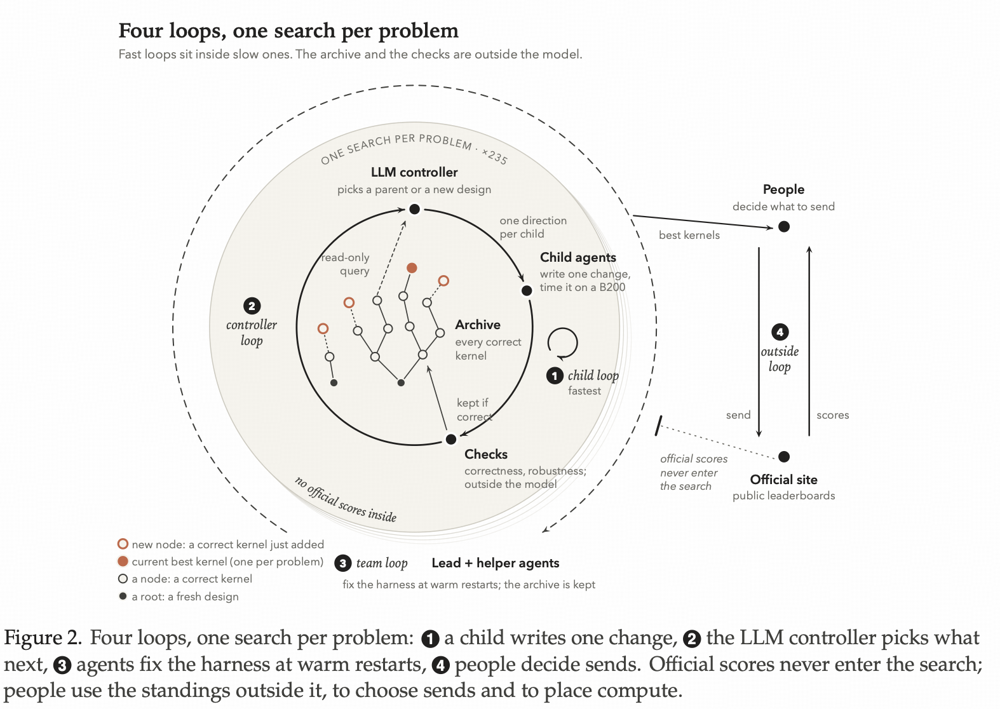
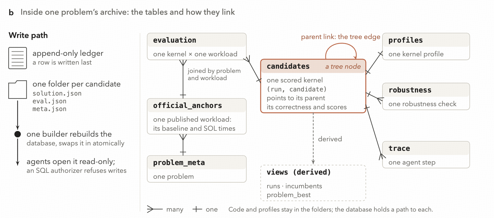
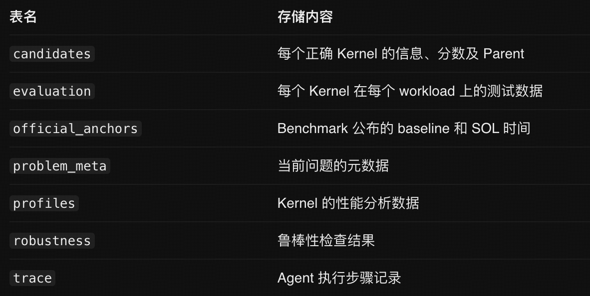

## Introduction

这篇论文主要介绍了一个Kernel Agent，截止2026年11月11日，其在Nvidia的公开GPU Kernel Leaderboard（SOL-ExecBench） 的L1，L2，Quantization三个类别上均排名第一。

其核心方法在于整个搜索方法完全从零开始，智能体只能访问每道题目的PyTorch定义，而无法访问参考的Kernel实现或官方评测结果。

系统会在模型外部为每道题目维护一个独立存档，用于保存所有已经验证了正确性的Kernel及其演化关系。一个由大语言模型驱动的控制器会读取该存档，选择已有内核作为改进起点（父代），或者提出一种全新的设计方案，并为每个并行运行的子智能体分配一个明确的优化方向。**正确性验证由模型外部的检查机制负责完成。**

最重要的是，在实验中，系统能够同时运行超过 **1,000 个智能体**。

## Motivation

和之前讨论过的一样，相比其他目标开放的agent任务，GPU Kernel优化有一个天然的优势：**可自动验证，性能指标清晰**。要放大这个优势，Agent系统的规模化是最关键的一环。

但论文点破了一个常规误区：在Kernel Agent的规模化中，真正决定上限的并不是并发Agent的数量本身，而是可以数值量化的产出速率，以及每次新尝试能否建立在准确的历史数据上。

围绕这一目标，大规模Kernel 搜索必须解决三个核心问题

1. **如何让搜索持续积累经验？** 单个LLM的上下文窗口有限，长周期优化产生的海量代码和评测记录无法全部塞进上下文

2. **如何保证大规模并发下的有效探索？** 如何在保持高并发吞吐的同时，让更多subagent能够work在有价值的方向上，而不是空转或互相等锁

3. **如何跳出局部最优？** 给定参考实现时，Agent往往倾向于围绕特定shape做微调，难以产生架构级的跃迁，我们真正期待的，是能提出类似FlashAttention这类结构级创新的Kernel Agent

## Method



整体上Compunding Kernel采用四层循环嵌套的架构，我们从内而外地来看它的设计。

最内层的Loop是Child Loop。它主要负责的是给定某个算子具体的优化方向后的探索任务。

它接受上一层循环带来的起点Kernel（可以为空），以及在起点Kernel上的Idea，也就是本次loop的探索方向。

然后开始如下循环:

```text
接收 Parent 和 Direction
          ↓
     生成 Kernel
          ↓
    编译 + 正确性测试
          ↓
     **是否通过验证**？
       ↙        ↘
      否         是
      ↓          ↓
  修改 Kernel   保存到 Archive
      ↓          ↓
   再次测试    结束 Child Loop
```

比较有意思的就是这个循环并**不追求性能**，而是以算子的**正确性通过为标准**。

之所以这样设计，我认为主要是为了将局部实现与全局搜索决策解耦：Child只需要快速把某一个具体的direction落地成正确且可测量的候选并立刻释放槽位，避免在单一方向上陷入低效长尾；至于这个候选值不值得继续挖掘，下一步该往哪走，则交给掌握全局信息Archive的Controller Loop统一判断。

另外需要强调的则是，这个算子的正确性是**通过一个外部的独立程序**进行的，从而避免hack。

往上一层则是Control Loop，也是本工作中最重要的一部分，它的主要工作是根据已有Kernel的正确性和性能信息，决定下一步应该探索什么方向。

论文中通过公式描述了这个Loop的一个step:

$(p,d) \sim \pi_{LLM}(· |A)$, $k' = Child(p,d)$, $A \leftarrow A \cup \{k'\} \text{if k' is correct}$

其中A就是我们优化的某个算子的通过正确性的Kernel集合，会包含这些Kernel的实现以及性能指标

需要注意的是，这里的 $\pi_{\text{LLM}}$是说我们让**LLM根据Archive直接通过自然语言指定父Kernel 以及 优化的方向**。

实际上这隐含了一个信息，就是我们认为一个预训练 & 后训练好的模型，其对于Nvidia最新架构的显卡的知识以及Kernel 优化的方法的知识都是相当充足的，且Archive中实际上也包含了一部分的信息，因此我们无需再额外接入一个知识库。

但话说回来，这是针对nv而言的，如果我们想实现对于多后端，尤其是国产后端的适配，我个人认为相关信息的输入也是必要的。

论文中Agent会通过只读SQL来查询Archive，而Archive中会保留这样的形式化信息:



具体来说Archive是一个以`candidates`表为中心的关系型数据库，其中



另外一个论文特别强调的设定在于，**所有Archive中的candidate都有可能作为父Kernel**，这其实包含的思想可以概括为允许单次失败，贪心很容易陷入局部最优，有时候架构层面的改动在第一次impl的时候并不会带来显著的提升，这是因为在写法上多多少少很难做到one shot best，因此我们应该保留目前较差的实现来追求上限更高的性能提升。

第二层Loop的结束条件并不是算子达到某个性能的加速比，而是会给定一个时间限制，要求control Loop只运行一定的时间从而**在有限时间内持续扩展搜索树，尽可能找到更高性能的 Kernel**。

而第三层循环则是Harness的RSI，论文中的名称叫Team Loop。其主要作用是**对整个Agent System**进行改进，让Loop1和Loop2的吞吐更加高效。

具体来说，这个Loop由三部分组成:

- Lead Agent: 主要负责监控运行，协调系统维护，并负责Kernel的打包与提交准备

- Helper Agent：协助诊断和修复 Harness、工具与基础设施问题

- Human：审批 Harness 修改和每次正式发布

我们可以通过一个实际的例子，来看它的具体作用:

在系统运行期间的某个Loop中，修复了一个GPU评测性能的瓶颈问题。

作者发现，虽然系统已经运行了超过一千个 Agent session，但 GPU 的实际利用率只有大约 **13%**。

原因不是没有足够多的 Child，而是评测系统出现了资源锁竞争。

原先执行的方式是:

```text
Child 请求评测
      ↓
获取 GPU Lock
      ↓
CPU 编译 Kernel
      ↓
启动 Shell（12–15 秒）
      ↓
GPU 测试与性能测量
      ↓
释放 GPU Lock
```

这里的问题就在于CPU 编译Kernel还有shell的启动并没有利用GPU，但是一直占用了GPU，带来了明显的资源浪费。

因此Team Loop对整体的Harness做了几项改动:

1. 将编译移除GPU Lock

2. 缩短shell的启动时间

3. 将profiling设置为可选

4. 将新最佳 Kernel 的额外验证移至基础设施

这项改动成功将单位时间评测候选的数量提升了接近4倍。

当然论文还提到了第四层Loop，这层Loop就和资源分配以及赛题相关了，我们这里不过多介绍。

## Key Finding & Thinking

这篇论文应该是继ForgeKernel后近期的一个SOTA工作，除了整体的架构的设计之外，论文还提供了很多有意思的发现，我们可以一起探讨一下。

1. 规模化的主要瓶颈在于有效搜索的数量，而不是runing的Agent的数量。 和我们之前的结论一致，我们需要解决agent大规模并行的正交问题。这篇论文中从各个父Kernel 出发从一定程度上可以缓解这个问题，因为它防止了IDEA扎堆

2. Stepping Stone，允许阶段性变慢是跳出局部最优的关键，这个是一个显然的事实。

3. 强加先验指导与跨题共享不一定有效。提供了实验论证

4. 没有强外部验证，强搜索只会更快找到reward hack （一个个人的实践经验是用codex进行快速的优化idea以及baseline实现，然后用国模或gemini验证）

当然，我们的目光当然不局限于NV这一单后端的场景，多后端的场景相较下来会复杂很多。

比如我们知道，在基础模型的预训练语料中，国产芯片的相关知识以及算子优化经验大概率是落到长尾的，而nv的相关知识因为生态的原因会丰富非常多，因此之前提到的外部验证以及跨题共享的问题会复杂很多。

这里的跨题共享的语义就会发生变化，比如FlashAttention在多个后端上的实现，那这样不同后端的实现就不一定不能够作为参考依据了。

除此以外，通过这篇文章我觉得目前Kernel Agent应该关注这几个点:

1. 规模化（本篇文章的父kernel机制）

2. 评测（本篇文章中的防作弊机制）

3. 端到端落地（TogetherCompiler中的做法）
